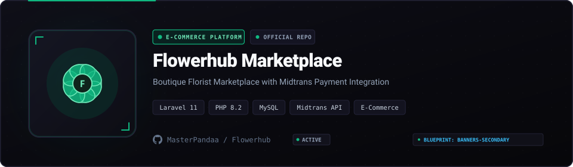

<p align="center">
  
</p>

<p align="center">
  
  
  
  
  <a href="LICENSE"></a>
</p>

## Overview

Florist businesses face distinctive e-commerce requirements: strict delivery date scheduling, recipient greeting card customization, and real-time inventory management across fragile perishable items. Flowerhub is an e-commerce platform built with **Laravel 11**, designed specifically for floral boutiques and gifting merchants.

The application integrates **Midtrans Snap** for automated payment verification across Indonesian bank transfers, QRIS, and e-wallets, paired with an administrative order tracking panel.

---

## Core Capabilities

- **Bouquet and Hamper Catalog**: Multi-image galleries with categorization for standing flowers, wedding arrangements, and personalized hampers.
- **Scheduled Gift Delivery**: Customers select specific delivery dates and add custom greeting card text during checkout.
- **Automated Payment Gateway**: Direct payment modal powered by Midtrans Snap supporting GoPay, ShopeePay, BCA, Mandiri, and BNI virtual accounts.
- **Live Order Tracking**: End-to-end status pipeline for orders (Payment Pending, In Arrangement, Out for Delivery, Delivered).
- **Administrative Role Control**: Granular permission boundaries for Florist Arrangers and Store Managers powered by Spatie RBAC.
- **Automated Image Optimization**: Media uploads are dynamically processed into responsive thumbnails using Intervention Image.

---

## Quickstart

### Prerequisites

- PHP 8.2+
- Composer and Node.js
- MySQL or MariaDB
- Midtrans Merchant Sandbox Account

### Installation

1. Clone the repository:
   ```bash
   git clone https://github.com/MasterPandaa/Flowerhub.git
   cd Flowerhub
   ```

2. Install dependencies:
   ```bash
   composer install
   npm install && npm run build
   ```

3. Configure environment:
   ```bash
   cp .env.example .env
   php artisan key:generate
   ```

4. Configure database and Midtrans keys in `.env`:
   ```env
   DB_DATABASE=flowerhub_db
   MIDTRANS_SERVER_KEY=SB-Mid-server-xxxx
   MIDTRANS_CLIENT_KEY=SB-Mid-client-xxxx
   MIDTRANS_IS_PRODUCTION=false
   ```

5. Run migrations and start server:
   ```bash
   php artisan migrate --seed
   php artisan storage:link
   php artisan serve
   ```
   Open `http://localhost:8000` in your browser.

---

## Repository Structure

```text
Flowerhub/
├── app/Http/Controllers/   # Product catalog, order checkout, and webhook handlers
├── app/Models/             # Product, Category, Order, and CardMessage entities
├── database/migrations/    # Database schema with foreign key constraints
├── resources/views/        # Responsive customer storefront and admin dashboard
└── README.md               # Platform documentation
```

---

## License

This project is licensed under the [MIT License](LICENSE).
